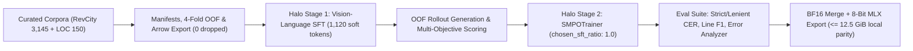
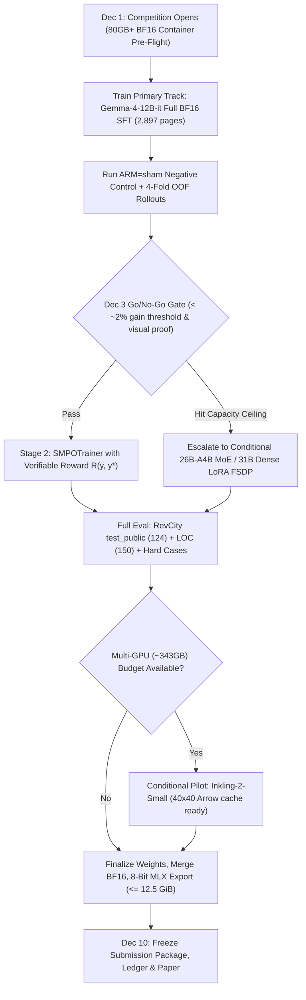

# Early American Handwritten Text Recognition via Structured Multi-Objective Post-Training: Pre-Competition Engineering, Tooling Architecture, and Execution Plan

**Project Repository:** `early-american-htr-halo` (Apache-2.0)  
**Competition Window:** December 1–10 (Re-run & Judging: December 11–17; Winners Announced: December 18)  

---

## Abstract

Transcribing 18th-century American manuscripts requires strict **diplomatic fidelity**: models must preserve original spelling, abbreviations, punctuation, and physical line breaks without silent editorial modernization, hallucinated bracketed markup, or runaway repetition loops. Off-the-shelf vision-language models (VLMs) frequently fail on these documents—producing degenerate dash-line loops, non-terminating generations, and unprompted modernization—while naive fine-tuning without document-aware splitting or layout controls risks severe data leakage and gradient collapse.

This paper summarizes the complete end-to-end engineering lifecycle of `early-american-htr-halo`, an open-source, clean-room post-training and evaluation pipeline built on the Halo framework (`whitecircle/halo@53fe34a`). We document:
1. **Everything completed prior to competition launch**, including leakage-free corpus curation, multi-fold out-of-fold (OOF) and cross-corpus benchmarks, custom VLM training configs not shipped upstream in Halo, pre-exported Arrow `DatasetDict` artifacts, Apple Silicon MLX export parity checks, and live 24 GB L4 QLoRA pilot runs demonstrating a **113.67 percentage-point reduction in strict CER** (`151.79%` zero-shot baseline down to `38.12%` after 124 training pages).
2. **The full execution plan for December 1–10**, detailing the progression from primary dense VLM post-training (`Gemma-4-12B-it`) and sham/OOF negative controls through conditional Mixture-of-Experts (`Gemma-4-26B-A4B-it`, `Inkling-2-Small`) and larger dense (`Gemma-4-31B-it`) tracks governed by explicit operational kill switches.
3. **The software, model, metric, and hardware stack**, spanning pinned Halo/PyTorch dependencies, verifiable reward math, 24 GB pilot GPUs, 80 GB+ Hopper/Blackwell/Ampere training nodes, multi-GPU vLLM serving, and local Apple Silicon MLX quantization.
4. **Explicit end goals and tiered success criteria**, establishing measurable scientific, engineering, and competition outcomes.

---

## 1. Problem Formulation & Empirical Motivation

Diplomatic handwritten text recognition (HTR) on Revolutionary-era American correspondence, ledgers, and institutional records diverges sharply from modern document OCR. Models must transcribe exact historical orthography line-for-line rather than producing modernized, normalized prose.

Pre-competition empirical testing identified four concrete failure modes that shaped the pipeline architecture:

1. **Runaway Repetition Loops & Budget Exhaustion:** On difficult or low-contrast 18th-century pages, zero-shot models enter degenerate decoding states, such as a **655 consecutive `-` lines loop**, exhausting the output token budget (`finish_reason == "length"`) rather than terminating cleanly. On a 24-page stratified validation panel, zero-shot Gemma-4-12B-it hit `loop_pages = 7/24` and `budget_capped_pages = 8/24`, yielding a mean verifiable reward of `-0.1715`.
2. **Bracketed Markup & Editorial Leakage:** The primary training corpus (`RevCity`) contains **`39%` bracketed spans** (editorial tags such as uncertainty markers or structural annotations) as well as **`8 / 1,687` confirmed ground-truth slips** documented during schema auditing. Unconstrained post-training easily teaches the model to hallucinate editorial bracket tokens (`0 → 11` bracket leakage incidents observed in early unconstrained baselines).
3. **Document-Group Data Leakage:** Naive page-level random splitting dramatically inflates apparent accuracy when pages from the same bound volume or scribe appear in both training and evaluation splits. Empirical leakage testing showed **`6.84 / 1.70`** (WER / CER under page-level split leakage) versus **`39.69 / 19.78`** when properly grouped by volume/document, motivating strict document-level and institutional grouping.
4. **Visual Resolution Starvation:** Standard VLM processors default to low visual token budgets (e.g., `280` soft tokens for Gemma 4), rendering small 18th-century ink strokes illegible and forcing language-prior guessing instead of visual reading.

### Architectural Scope & Boundaries (Non-Goals)

To isolate diplomatic transcription quality cleanly within Halo's SFT + reinforcement post-training loop, `early-american-htr-halo` explicitly enforces the following scope boundaries:
- **In Scope:** Single-pass diplomatic page-image-to-text transcription preserving original orthography, capitalization, punctuation, and line breaks (`\n`).
- **Explicit Non-Goals:** Word-level bounding box geometry prediction, structured JSON layout extraction, and writer/scribe identification are kept outside the Halo VLM post-training target. Keeping the generation target pure text prevents token-budget exhaustion and formatting fragility while letting Stage 2 preference/RL optimization (`SMPOTrainer`) directly target character accuracy, word accuracy, formatting hygiene, and clean end-of-turn (`<turn|>`) stopping.

---

## 2. Corpus Engineering, Hygiene & Verified Splits

All training and evaluation data strictly use **CC-BY-4.0** and **Public Domain** historical corpora, structured into leak-free splits and pre-compiled into Hugging Face Arrow `DatasetDict` caches prior to December 1.

### 2.1 Primary Corpus: RevCity (CC-BY-4.0)

- **Source Archive:** Zenodo Record `15776323` (`revcity-htr.zip` + `CITATION.cff`; verified `9,988,850,095` bytes, MD5 `c291f2ebda6e5698f788a06b9520c709`).
- **Filtering & Ingestion Rules:** Out of `3,316` paired image/ALTO-XML stems, **`171` hard-case rows** are quarantined from active training/standard validation into a dedicated `hard_case_panel` (`107` pages with `< 8` words, `43` table leader-dot pages, `16` empty ALTO `missing_or_unverified_gt` pages, and `5` duplicate-line slips; `8` of these are held out separately as `hard_case_held_out_pages`).
- **Active Split Composition (`3,145` admitted pages: `3,071` `.jpg` + `74` `.png`):**

| Split | Pages | Share | Groups / Volumes | Institutional Breakdown (`APS / HSP / LCP / MSS`) | Two-Page Openings | Word Count |
|---|---:|---:|---:|---|---:|---:|
| **`train`** | `2,897` | `92.1%` | `17` large volumes | `1,424 / 1,303 / 124 / 46` | `1,460` | `613,663` |
| **`val`** | `124` | `3.9%` | `21` document groups | `83 / 31 / 4 / 6` | `12` | `24,606` |
| **`test_public`** | `124` | `3.9%` | `21` document groups | `94 / 10 / 16 / 4` | `19` | `21,321` |

- **Hygiene & Audit Verification:** `corpus_audit_report.json` confirms **`0` split collisions** across all pairwise audits (`val`, `test`, `val_test`: `passed: true`) and **`0` `dhash_review_candidates`** (near-duplicate image hashes across split boundaries). Collection attribution incorporates explicit `REVCITY_COLLECTION_OVERRIDES` where Zenodo metadata lacked creator CSV/JSON tables.

### 2.2 Cross-Corpus Generalization Panel: LOC *By the People* (Public Domain)

To verify that post-trained models learn general 18th-century paleography rather than RevCity-specific scanning artifacts, a standalone evaluation-only panel (`challenge_loc`) was built from Library of Congress *By the People* (**LCCN `2020446971`**, Public Domain):
- **Verified Composition:** **`150` admitted pages** (`11,167` words) across `3` archival items (`loc:mgw500029`: `109` pages; `loc:mgw6a00007`: `30` pages; `loc:mgw6a00008`: `11` pages).
- **Quarantined Hard Cases:** `19` pages excluded from standard scoring (`14` `< 8` words, `4` leader dots, `1` duplicate slip).
- **Zero-Leakage Audit:** `0` hash/document collisions against RevCity `train`, `val`, or `test_public`.

### 2.3 Real 4-Fold Out-of-Fold (OOF) Shards

Because Halo Stage 2 preference/reward optimization consumes Stage 1 SFT rollouts, generating Stage 2 preference pairs on training pages seen by the same SFT weights risks overconfident collapse. We pre-built a verified **4-fold document-grouped OOF partition** (`oof_folds_summary.json`) over the `2,897` training pages:
- **Fold 0:** `2,166` train / `731` OOF (`13 / 4` documents) — `passed: true`
- **Fold 1:** `2,174` train / `723` OOF (`13 / 4` documents) — `passed: true`
- **Fold 2:** `2,187` train / `710` OOF (`13 / 4` documents) — `passed: true`
- **Fold 3:** `2,164` train / `733` OOF (`12 / 5` documents) — `passed: true`

### 2.4 Pre-Exported Arrow `DatasetDict` Artifacts

All three multimodal Arrow caches (`datasets.load_from_disk` verified, `0` dropped rows across all splits) are pre-staged and checksum-verified before competition start:
1. **`halo_vlm_sft`** (`8.6 GiB`): `2,897` train / `124` val rows for `Gemma-4` diplomatic HTR.
2. **`halo_vlm_sft_sham`** (`8.6 GiB`): `2,897` train / `124` val control rows pairing images with shuffled-page ground-truth targets (`ARM=sham`) to isolate visual-grounding gains from format/style adaptation.
3. **`halo_inkling2_vlm_sft`** (`14 GiB`): `2,897` train / `124` val rows formatted for `Inkling-2-Small` (`40x40`-aligned patch grids, verified `max_vision_tokens = 1995 <= 2000`).

---

## 3. Architecture, Tooling Stack, Models & Evaluation

### 3.1 System Architecture

### 3.2 Software & Framework Stack

Upstream `whitecircle/halo@53fe34a` did not ship VLM training configurations for either the Gemma 4 Unified or Inkling 2 model families. `early-american-htr-halo` fills this gap with validated custom configurations, chat templates, and pinned runtime libraries:

- **Core Post-Training Engine:** `whitecircle/halo@53fe34a` paired with `gram-newton-schulz@244a451d684a39d68f593aef03b6fe7cfa6a31d1`.
- **Pinned Python ML Stack:** `torch==2.11.0`, `transformers==5.23.0`, `trl==1.14.2`, `peft==0.18.1`.
- **Container & Driver Compatibility:** NVIDIA driver `>= 560.28`; official Halo competition container targets `public.ecr.aws/whitecircle/halo:hopper-1.3.0rc2`, `:blackwell-1.3.0rc2`, and `halo:vllm-0.1.dev25249`.
- **Local Apple Silicon Stack:** `mlx==0.32.5` and `mlx-vlm==0.8.1` (providing native `mlx_vlm.models.gemma4_unified` and `inkling2` architectures), verified with CLI flags `--hf-path`, `--mlx-path`, and `-q --q-bits 8`.
- **Repo Hygiene & Offline CI Verification:** Automated CPU test suites pass cleanly in two isolated virtual environments (`65 passed, 3 skipped` and `68 passed`), all custom configs pass schema validation (`11/11` Tier-1 and `11/11` Tier-2 checks against upstream `halo@53fe34a`), notebooks pass AST checks, max `.py` module length is bounded (`450` lines in `src/eahtr/halo_smoke.py`), and GitHub Actions CI passes clean-room checks (`0` leakage matches).

### 3.3 Target Models & Critical Engineering Fixes

| Role | Model (`Pinned Revision`) | Architecture & Parallelism | Critical Pre-Flight Configurations |
|---|---|---|---|
| **Primary Track** | `google/gemma-4-12B-it` (`43c9d014b231`, Apache-2.0) | Dense `Gemma4UnifiedForConditionalGeneration` (`gemma4_unified`) | Staged `1,120` visual soft tokens (`stage_gemma4_highres.py`); `sdpa` attention; `gemma4_htr_nothink.jinja` template; `<turn|>` EOS token id `106`; completion-only `logits_to_keep=keep_mask` + bf16 embedding cast |
| **Conditional MoE Fallback** | `google/gemma-4-26B-A4B-it` (`4d7ae4984b7db7de8f8457170b3f1a419ee76d52`) | Sparse MoE (`EP=8`) | Full BF16 training + `convert_to_bf16.py --verify` check before merge/eval |
| **Conditional Scale Fallback** | `google/gemma-4-31B-it` (`842da3794eaa0b77d5f08bae87a17459d91ff475`) | Dense FSDP LoRA | Escalated only if `12B` hits capacity ceiling below target CER |
| **Conditional Track** | `thinkingmachines/Inkling-2-Small` (`885d78bfca61a7e9a498e33cfa7ad35850533b8c`) | `Inkling2ForConditionalGeneration` (`48L × 384E` frozen NVFP4/MXFP8 experts, `EP=8`) | `inkling2_htr_nothink.jinja` (effort `0.0`); `pad_token: "<|endoftext|>"`; `40x40`-aligned visual patching (`max_vision_tokens = 1995 <= 2000`); vLLM serving requires `~343 GB` aggregate GPU VRAM (`halo:vllm-0.1.dev25249`); excluded from local 24 GB MLX gate |

Two subtle engineering bugs were caught and fixed before competition launch:
1. **Silent Low-Res Default:** Without explicit processor staging (`stage_gemma4_highres.py`), Gemma 4 silently downsamples page images to `280` soft tokens instead of `1,120`. Our smoke harness explicitly logs batch-0 processor vs. tensor visual token counts (`proc=1092`, `batch=1092`) to guarantee high-resolution input.
2. **VRAM OOM During Logit Materialization:** Materializing full-sequence logits over the large Gemma 4 vocabulary triggered 24 GB VRAM OOMs until `logits_to_keep=keep_mask` (computing loss strictly over completion tokens) and bf16 embedding casting were wired in—eliminating OOMs completely across all `124/124` pilot steps.

### 3.4 Multi-Objective Verifiable Reward & Diagnostic Metrics

Rather than optimizing cross-entropy alone, Stage 2 post-training (`SMPOTrainer`, configured with `chosen_sft_ratio: 1.0` to anchor policy updates to diplomatic SFT) uses a deterministic, verifiable page-level reward function:

$$R(y, y^{\ast}) = 0.6 \max\left(0,\, 1 - \text{CER}_{\text{strict}}(y, y^{\ast})\right) + 0.4 \max\left(0,\, 1 - \text{WER}_{\text{strict}}(y, y^{\ast})\right) - 0.05\, P_{\text{mod}}(y, y^{\ast}) - 0.10\, P_{\text{fmt}}(y) - 0.25\, P_{\text{trunc}}(y, y^{\ast})$$

In addition to linear penalties for editorial modernization (`P_mod`), formatting/bracket violations (`P_fmt`), and premature truncation (`P_trunc`), $R(y, y^{\ast})$ enforces a **hard `-1.0` reward floor** on:
- Non-terminating outputs (`finish_reason == "length"`),
- `>= 4` consecutive repeated lines or standalone dash tokens (exempting repeats legitimately present in `reference`),
- `>= 5` consecutive n-gram cycles, or
- Non-empty hallucinations on blank verso pages.

To prevent metric gaming, evaluation tracks multiple complementary axes via `eval_analysis.py` and `analyze_eval_predictions.py`: **`strict_cer_pct`**, **`strict_wer_pct`**, **`lenient_cer_pct`**, **`raw_strict_cer_pct`**, **`newline_cer_pct`**, **`line_boundary_f1_pct`**, **`order_tolerant_cer_pct`**, **`mean_verifiable_reward`**, **`loop_pages`**, **`budget_capped_pages`**, **`non_terminated_pages`**, **`editorial_leaks`**, **`modernizations`**, and **`thinking_leak_pages`**, backed by `independent_recount_verified=True` checks.

### 3.5 Hardware Tiers Across the Lifecycle

1. **Pre-Competition Pilot Hardware (`24 GB` NVIDIA L4, `22.49 GiB` usable VRAM, driver `580.82.07`):** Used to verify 4-bit QLoRA training stability, gradient propagation through `model.embed_vision`, Stage 1 → Stage 2 `SMPOTrainer` handoff continuity, and 124-page `ARM=real` convergence (`0/124` OOMs).
2. **Local Edge & Parity Hardware (Apple M3 Max, `36 GB` Unified Memory):** Used to develop, test, and verify offline datasets, schema validators, and `8-bit` MLX quantization (`<= 12.5 GiB` footprint target for `Gemma-4-12B-it`).
3. **Competition Compute Tier (`80 GB+` H100 / A100 / Blackwell & Multi-GPU Nodes):** Dedicated full-BF16 training capacity (avoiding 4-bit quantization loss during full 2,897-page SFT, 4-fold OOF rollouts, and `SMPOTrainer`), scaling up to multi-GPU `~343 GB` VRAM clusters if conditional MoE tracks (`26B-A4B`, `Inkling-2-Small`) are activated.

---

## 4. Work Completed to Date & Verified Pilot Results

### 4.1 5-Step L4 QLoRA & Stage 1 → Stage 2 Continuity Smoke

Before scaling to a 124-page pilot, a 5-step end-to-end smoke test on a 24 GB L4 verified every handoff in the Halo pipeline:
- **Visual Token & EOS Integrity:** Batch-0 confirmed `proc=1092`, `batch=1092`, and `eot_id=106` (`<turn|>`), with natural `<turn|>` termination after training.
- **Stage 1 SFT Execution:** Loss dropped from `1.644 → 1.194` (`train_loss = 1.462` in `175.7s`), confirming active gradient updates across trainable vision LoRA modules.
- **Stage 1 → Stage 2 Continuity:** `SMPOTrainer` step-0 logits verification recorded `base → SFT shift = 3.31727` and `stage2 → base = 3.587596` (`0.0` discrepancy under matching FP32-norm + `autocast`), completing 5 SMPO steps (`2.242 → 2.503`, `train_loss = 2.359` in `320.7s`).
- **Adapter Merge & Local Parity Handshake:** `merge_peft_adapters.py` and `verify_mlx_export.py` verified config-level `1,120` soft tokens, `chat_template_verified: true`, `reference_token_parity: true`, and `reference_image_parity: true`.

### 4.2 124-Page Colab `ARM=real` Pilot vs. Zero-Shot Baseline

Running Stage 1 QLoRA SFT across `124/124` training pages on a single 24 GB L4 completed in **`10m 55s` with `0` OOMs** (`loss = 1.4739`, `1,066` mean image tokens, updating `model.embed_vision` `294,912` params + `65,640,448` LoRA params) and achieved transformative gains on the 24-page stratified validation panel:

| Metric (24 Stratified `val` Pages) | `baseline_zeroshot` | `ARM=real` (`124/124` pages, 24 GB L4) | Delta / Observation |
|---|---:|---:|---|
| **`strict_cer_pct`** (lower better) | `151.79%` | **`38.12%`** | **`-113.67 pp`** |
| **`strict_wer_pct`** (lower better) | `159.99%` | **`57.35%`** | **`-102.64 pp`** |
| **`lenient_cer_pct`** | `103.03%` | **`33.98%`** | `-69.05 pp` |
| **`raw_strict_cer_pct`** | `149.43%` | **`37.80%`** | `-111.63 pp` |
| **`newline_cer_pct`** | _n/a_ | `38.69%` | Line-aware alignment tracked |
| **`line_boundary_f1_pct`** | _n/a_ | `14.84%` | Clear headroom for Stage 2 + full BF16 |
| **`order_tolerant_cer_pct`** | _n/a_ | `35.89%` | Reading-order errors isolated cleanly |
| **`mean_verifiable_reward`** (higher better) | `-0.1715` | **`+0.5595`** | **`+0.7310`** |
| **`loop_pages`** | `7 / 24` | **`2 / 24`** | Degenerate loops cut by `71%` |
| **`budget_capped_pages`** | `8 / 24` | **`2 / 24`** | Truncations cut by `75%` |
| **`non_terminated_pages`** | _n/a_ | `2 / 24` | Remaining targets for Stage 2 `-1.0` floor |
| **`editorial_leaks` / `modernizations` / `thinking_leak_pages`** | `n/a / n/a / 0/24` | **`0 / 0 / 0`** | Zero bracket leakage or thinking leaks |

- **Negative-Control Causal Proof (16-Page Same-Checkpoint Swap Test):** Evaluating the trained `ARM=real` checkpoint against swapped image/page pairings degraded CER by **`+79.75 pp`** (`swap CER = 117.01%`), proving that the accuracy improvement is genuinely driven by **visual manuscript reading**, not memorized text priors.

### 4.3 Compute Allocation Discovery (Colab Pro+ Probes)

Nine consecutive automated probes on Colab Pro+ (`checks #1–#9`) returned `0` H100 or A100 allocations (falling back to T4/L4 or timing out `> 90s`). Rather than discovering hardware bottlenecks on December 1, this pre-flight probe establishes early that genuine `80 GB+` BF16 execution (`>= 56 GiB` free VRAM) during the competition will rely on partner compute credits or dedicated Hopper/Blackwell/Ampere cloud pods running Halo's official ECR containers.

---

## 5. Competition Execution Plan (December 1–10) & Decision Gates

The Halo Competition offers **\$200,000** in cash prizes and **\$1.5M** in compute/API credits across **17 tracks and 11 partners**. Our 10-day execution schedule follows a strictly gated, evidence-driven progression designed to fail fast on dead ends and concentrate compute on verified wins.

### 5.1 Phased Schedule

- **Phase 1 — Infrastructure Pre-Flight & Full BF16 Primary SFT (Dec 1–2):**
  - Spin up `80 GB+` Hopper/Blackwell/Ampere pod using Halo's official container (`hopper-1.3.0rc2` / `blackwell-1.3.0rc2`) and mount pre-built Arrow `DatasetDict`s (`halo_vlm_sft`, `halo_vlm_sft_sham`).
  - Execute full-corpus (`2,897` pages) Stage 1 BF16 SFT on `google/gemma-4-12B-it`, logging batch-0 `1,120` soft tokens and `train/val` convergence.
  - Execute `ARM=sham` control run using `halo_vlm_sft_sham` to establish the exact causal contribution of aligned image-text training over format tuning alone.
- **Phase 2 — 4-Fold OOF Generation & Dec 3 Go/No-Go Gate (Dec 3):**
  - Train the 4 pre-audited OOF fold checkpoints (`passed: true` splits) and generate unbiased out-of-fold rollout candidates on each fold's held-out `~710–733` training pages.
  - **Dec 3 Decision Gate:** Confirm strong separation (`> ~2%` improvement / clear visual grounding over `ARM=sham` and zero-shot) and verify `line_boundary_f1_pct`, bracket leakage (`0`), and OOF rollout diversity before spending Stage 2 RL compute.
- **Phase 3 — Stage 2 Multi-Objective `SMPOTrainer` & Scale/MoE Tracks (Dec 4–7):**
  - Train Stage 2 `SMPOTrainer` (`chosen_sft_ratio: 1.0`) scored by $R(y, y^{\ast})$, targeting remaining `non_terminated_pages`, `loop_pages`, and `line_boundary_f1_pct` gaps observed in the Stage 1 pilot.
  - If `12B` hits an accuracy plateau or partner track capacity warrants scaling, activate `google/gemma-4-26B-A4B-it` (MoE `EP=8`, verified via `convert_to_bf16.py --verify`) and/or `google/gemma-4-31B-it` (dense FSDP LoRA).
  - If multi-GPU `~343 GB` vLLM serving capacity is allocated, execute the conditional `thinkingmachines/Inkling-2-Small` track using the pre-exported `14 GiB` `halo_inkling2_vlm_sft` Arrow dataset.
- **Phase 4 — Blind Evaluation, Cross-Corpus Stress Test & MLX Parity (Dec 8–9):**
  - Evaluate frozen best checkpoints once each on `test_public` (`124` RevCity pages), `challenge_loc` (`150` LOC *By the People* pages), and `hard_case_held_out_pages` (`8` pages) using `eval_analysis.py` (`independent_recount_verified=True`).
  - Merge final `12B` LoRA adapters into BF16 (`merge_peft_adapters.py`), quantize to 8-bit MLX (`mlx-vlm 0.8.1`), verify footprint (`<= 12.5 GiB`) and inference fidelity on Apple M3 Max (`36 GB`).
- **Phase 5 — Submission Freeze & Final Write-Up (Dec 10):**
  - Update `results/README.md` ledger with exact verified hashes, commands, and metrics; verify reproducibility per `docs/REPRODUCIBILITY.md`; submit prior to the Dec 10 close (ahead of Dec 11–17 re-runs and Dec 18 winner announcements).

### 5.2 Operational Kill Switches

To prevent wasted GPU hours during a compressed 10-day window, four hard kill switches govern every run:
1. **Visual Token Mismatch Abort:** Any run whose batch-0 log fails to report expected high-resolution visual tokens (`1,120` staged for Gemma 4; `<= 2,000` `40x40`-aligned for Inkling 2) aborts immediately.
2. **EOS / Thinking Leak Abort:** Any run producing `<think>` tokens (`thinking_leak_pages > 0`) or failing `<turn|>` (`id=106`) / `<|endoftext|>` termination in Stage 1 sanity samples halts before full epoch spend.
3. **`ARM=sham` & Swap Collapse Abort:** If `ARM=real` fails to cleanly outperform `ARM=sham` or shows negligible swap degradation, training halts to audit data/vision gradient flow (`model.embed_vision`).
4. **SMPO SFT-Anchor Collapse Abort:** Any Stage 2 run showing sudden reward hacking (`editorial_leaks > 0`, length collapse, or divergence without `chosen_sft_ratio: 1.0` anchoring) rolls back to the best verified OOF/SFT checkpoint.

---

## 6. End Goals & What Success Looks Like

Success is evaluated across three explicit, non-overlapping tiers so that both competition ranking and long-term open-source scientific utility are guaranteed.

### Tier 1: Engineering Reproducibility & Scientific Integrity (Must-Hit)
- **Zero-Leakage Provenance:** `100%` of training, OOF, and evaluation runs operate solely on audited splits (`0` cross-split collisions, `0` dHash candidates, `0` unverified ground-truth pages in standard scores).
- **Complete Ablation Accounting:** Publish verified side-by-side results in `results/README.md` comparing `baseline_zeroshot`, `ARM=sham`, Stage 1 Full-BF16 SFT, and Stage 2 SMPO across both RevCity `test_public` (`124` pages) and out-of-distribution LOC `challenge_loc` (`150` pages).
- **Reproducible Open Artifacts:** Clean Apache-2.0 codebase passing offline CI, pinned Halo/PyTorch dependencies, and deterministic verification scripts (`validate_halo_configs.py`, `verify_mlx_export.py`, `independent_recount_verified=True`).

### Tier 2: Accuracy, Line Fidelity & Failure-Mode Elimination (Competition Winning Bar)
- **Decisive Improvement Beyond the 124-Page L4 Pilot:** Push `strict_cer_pct` and `strict_wer_pct` substantially below the pre-competition 124-page QLoRA marks (`38.12%` strict CER / `57.35%` strict WER) when training on all `2,897` pages in full BF16 plus Stage 2 `SMPOTrainer`.
- **Structural & Diplomatic Precision:** Drive strong gains in `line_boundary_f1_pct` (from `14.84%` in the short SFT pilot) and `newline_cer_pct` while maintaining **`0` `editorial_leaks`**, **`0` `modernizations`**, and **`0` `thinking_leak_pages`**.
- **Complete Loop & Truncation Suppression:** Drive `loop_pages`, `budget_capped_pages`, and `non_terminated_pages` down from `2/24` (QLoRA pilot) toward **`0 / N`** across both RevCity and LOC panels via Stage 2's `-1.0` reward floor.
- **Verified Cross-Corpus Transfer:** Demonstrate substantial CER/WER and reward improvements on the unseen Public Domain LOC *By the People* panel (`150` pages, `11,167` words), proving generalization across archives, ink contrast, and page layouts.

### Tier 3: Edge Deployment & Competition Readiness (Dec 10 Deliverable)
- **Consumer-Hardware Parity (`<= 12.5 GiB`):** Deliver an 8-bit MLX-quantized `Gemma-4-12B-it` artifact via `mlx-vlm 0.8.1` fitting comfortably inside `<= 24 GB` / `36 GB` Apple Silicon unified memory with verified visual-token (`1,120`) and chat-template parity and minimal quantization CER degradation relative to full BF16.
- **Audit-Ready Competition Package:** Freeze and submit complete training logs, reward curves, failure-mode breakdowns, negative-control proofs (`ARM=sham` + swap tests), and reproducible configs ahead of the December 10 deadline—standing up cleanly to the December 11–17 Halo rerun audit.
